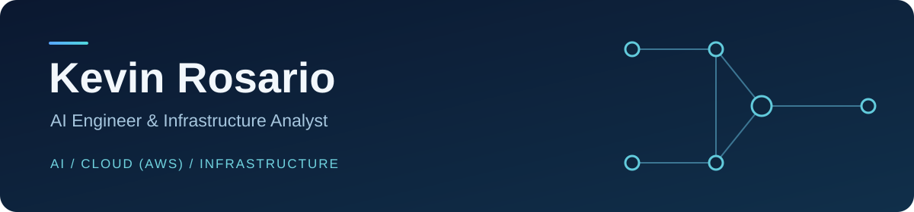

**Practical AI. Reliable infrastructure. Tools that solve everyday problems.**

[Projects](#selected-projects) · [Focus](#what-im-building-toward) · [Toolbox](#toolbox) · [Connect](#connect)

## Hi, I'm Kevin

I'm an AI engineer and infrastructure analyst based in Puerto Rico. I build AI-assisted tools and automation on top of a hands-on infrastructure background — networking, Windows Server and Active Directory, Microsoft 365, and cloud — with **AWS** as my cloud focus.

I use Python, PowerShell, and Bash to automate recurring work, and LLMs (Claude and local models) to design, build, and ship faster.

## What I'm building toward

- **AI engineering** — LLM-powered apps, agents, and tool use with the Claude API (Anthropic Academy coursework in progress)
- **Cloud** — deploying and running AI workloads on AWS
- **Infrastructure** — networking (CCNA in progress) and security fundamentals that keep AI systems reliable

## Selected projects

### [Bibles — Bible passages in OBS Studio](https://github.com/Numericss/Bibles)

A macOS-ready package for selecting Bible passages in a dock and displaying them through an OBS browser overlay. Includes multiple translations and local installation scripts.

**My recent work:** Improved server readiness checks, made custom ports consistent, clarified setup URLs, and added regression tests.

`Ruby` · `JavaScript` · `Shell` · `OBS Studio`

[Source & setup](https://github.com/Numericss/Bibles#readme) · [Networking walkthrough](docs/local-service-troubleshooting.md)

### [Hinge — Desktop effects for macOS](https://github.com/Numericss/Hinge)

A native macOS app that responds to a compatible MacBook lid sensor with desktop effects. Built on MacDuo, with motion presets, a menu-bar panel, and setup controls. **Version 3.0 is a development preview.**

`Swift` · `Metal` · `macOS`

See the effect preview

*Renderer demonstration using generated artwork, not a recording of physical lid movement or desktop capture.*

[Source & build instructions](https://github.com/Numericss/Hinge#readme)

## Infrastructure in practice

### [Troubleshooting a local service: ports, HTTP, and browser communication](docs/local-service-troubleshooting.md)

A walkthrough of the Bibles setup: identify the listener, check the application response, compare browser origins, and separate server failures from overlay failures. Includes a connection diagram, read-only commands, and expected results.

**Key distinction:** An open port proves that something is listening. An application health check helps confirm that the expected service is responding.

## Toolbox

| Area | Technologies |
| :--- | :--- |
| AI & LLMs | Claude, Claude Code, Claude API, LM Studio (local models) |
| Cloud & productivity | AWS, Azure, Microsoft 365, Google Cloud |
| Languages & automation | Python, TypeScript, PowerShell, Bash |
| Security & networking | Microsoft Sentinel, Wireshark |
| Data & reporting | Power BI |
| Development & deployment | VS Code, Vercel, Cloudflare |

## Connect

[Find me on GitHub](https://github.com/Numericss) · [Browse all repositories](https://github.com/Numericss?tab=repositories)

For questions or feedback about a project, use its repository's Issues tab.

---

*“Those who hope in the Lord will renew their strength.”*  
**Isaiah 40:31**

